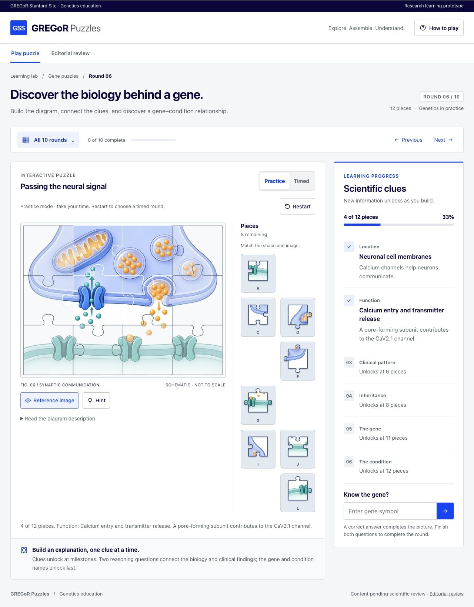

# GREGoR Puzzles

Image puzzles for learning rare disease genetics. Ten rounds connect molecular mechanisms, clinical phenotypes, inheritance, and variant interpretation.

## Try the game

**[Open in GitHub Codespaces](https://codespaces.new/sasha-gladkikh/gregor-puzzles)** → Create codespace → open **GREGoR Puzzles** on port **4173**. The game starts automatically. Requires repository access and Codespaces availability.

**Run locally** with [Node.js 24 LTS](https://nodejs.org/en/download):

```sh
git clone https://github.com/sasha-gladkikh/gregor-puzzles.git
cd gregor-puzzles
npm start
```

Open **[localhost:4173](http://localhost:4173)**. No package installation is required. The repository is private; sign in to GitHub or [download the source](https://github.com/sasha-gladkikh/gregor-puzzles/archive/refs/heads/main.zip) if cloning requires authentication.



## Play

1. Select a piece, then its position. Mouse dragging also works.
2. Answer two questions as scientific clues appear.
3. Complete the image to reveal the gene, condition, and annotated mechanism.

Each round has 12 pieces. Practice is untimed; progress saves in your browser. Phone controls use tap-to-place. **Editorial review** provides the full clinical content, HPO terms, explanations, and references without completing a puzzle.

## Scientific status

**Research education prototype. Scientific review pending.** Content draws on GeneReviews, MedlinePlus Genetics, and primary literature, with links to OMIM condition records. Illustrations are conceptual. No patient records are included. Learning outcomes have not been evaluated.

[Conditions and evidence](docs/SCIENCE.md) · [Reviewer guide](docs/REVIEW.md) · [Development](docs/DEVELOPMENT.md) · [Report an issue](https://github.com/sasha-gladkikh/gregor-puzzles/issues/new/choose)
